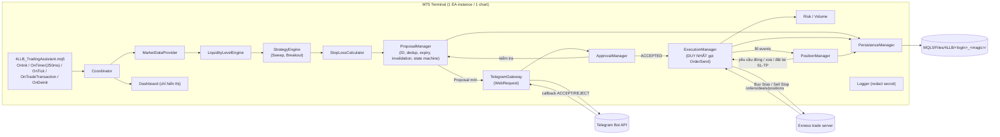

# Phase 1 — Architecture Blueprint

**Trạng thái:** `Designed`. Áp dụng quyết định D-01…D-04 và các Default A-01…A-35 (Phase 0).

## 1. Sơ đồ module



Không có mũi tên nào từ StrategyEngine, Dashboard, TelegramGateway hay ApprovalManager tới `OrderSend`. Chỉ `ExecutionManager` chứa `OrderSend` / `OrderCheck` (kiểm chứng bằng grep tĩnh, test XT-STATIC-01).

## 2. Trách nhiệm và quyền sở hữu dữ liệu

| Module | File | Trách nhiệm | Sở hữu dữ liệu |
|---|---|---|---|
| Coordinator | `LLB_Coordinator.mqh` | Vòng đời, lịch timer, multi-symbol, khoá instance, startup recovery, định dạng thông báo | `LLBSymbolContext[]`, cấu hình |
| MarketDataProvider | `LLB_MarketData.mqh` | Spec symbol, nến M15/D1, ATR, tick (CopyTicksRange), phiên giao dịch, server time | Không giữ state nghiệp vụ |
| LiquidityLevelEngine | `LLB_Levels.mqh` | Pivot 3-3, PDH/PDL, P3/P4 "as-of" một nến bất kỳ (hàm thuần) | — |
| StrategyEngine | `LLB_Strategy.mqh` | Phát hiện Sweep, Breakout trên nến đã đóng (hàm thuần) | — |
| StopLossCalculator | `LLB_StopLoss.mqh` | Buffer, SL, TP (RR 1:2), chuẩn hoá tick, kiểm tra hình học (hàm thuần) | — |
| ProposalManager | `LLB_Proposals.mqh` | Tạo Proposal, Signal ID, chống trùng, hết hạn, invalidation, chuyển trạng thái hợp lệ | `LLBTradeProposal[]`, bộ đếm số thứ tự |
| TelegramGateway | `LLB_Telegram.mqh` | Token, khoá gateway, hàng đợi gửi, polling `getUpdates`, offset, backoff, answer callback | Outbox, inbox, offset |
| ApprovalManager | `LLB_Approval.mqh` | Xác thực callback, allowlist, idempotency, chuyển ACCEPTED/REJECTED, gọi ExecutionManager | — (thao tác qua ProposalManager) |
| Risk | `LLB_Risk.mqh` | Volume (LotSize / RiskPercent), Daily Loss Limit | — |
| ExecutionManager | `LLB_Execution.mqh` | Precheck, `OrderCheck`, ghi SUBMITTING, `OrderSend`, phân loại retcode, xoá lệnh chờ, đóng vị thế, đặt lại SL/TP đúng giá trị dự kiến, reconciliation lệnh | `LLBExecutionRecord[]` |
| PositionManager | `LLB_Positions.mqh` | Nhận fill, xác minh SL/TP, ownership (netting), structure state, đóng do invalidation, ghi kết quả đóng | `LLBManagedPosition[]` |
| PersistenceManager | `LLB_Persistence.mqh` | Journal CSV có CRC32, state file nguyên tử (tmp → verify → move) | File |
| Dashboard | `LLB_Dashboard.mqh` | Vẽ nhãn chart; **không có nút giao dịch** | Object chart |
| Logger | `LLB_Logger.mqh` | Log có cấp độ, ra Journal + file ngày, che token | File log |

## 3. Luồng sự kiện

### 3.1 Chu kỳ `OnTimer` (250 ms)

```text
1. now = TimeTradeServer(); cập nhật trạng thái kết nối, heartbeat khoá (10 s)
2. Nếu chưa xong startup recovery: chờ terminal kết nối ổn định ≥ 3 s → chạy recovery (Phase 2 §8)
3. Mỗi symbol: đọc tick; ProposalManager.ProcessExpiry(now)
4. Mỗi symbol có đối tượng cần theo dõi: CopyTicksRange(từ lần quét trước) → touch?
     Proposal ACTIVE  → INVALIDATED
     Lệnh chờ sống    → ExecutionManager.DeleteOrder
     Vị thế mở        → PositionManager → ExecutionManager.ClosePosition
5. Mỗi symbol: nến M15 mới? → Levels → Strategy → StopLoss → ProposalManager.Create → Telegram outbox
6. Telegram: poll (≥ 1.5 s, có backoff) → callback → ApprovalManager → (ExecutionManager.Execute) → flush outbox
7. Reconcile (mỗi 2 s hoặc ngay sau OnTradeTransaction): ExecutionManager → events → PositionManager
8. Lưu system_state.dat khi dirty (≤ 1 lần/giây; journal được ghi ngay khi đổi trạng thái)
9. Dashboard (mỗi 1 s)
```

`OnTick` chỉ gọi bước 4 cho symbol của chart (giảm độ trễ); `OnTradeTransaction` chỉ bật cờ reconcile — **không phải nguồn sự thật**.

### 3.2 Luồng ACCEPT (tóm tắt — chi tiết ở Phase 2 §7)

```mermaid
sequenceDiagram
  participant U as User (Telegram)
  participant G as TelegramGateway
  participant A as ApprovalManager
  participant P as ProposalManager
  participant E as ExecutionManager
  participant B as Broker
  U->>G: bấm ACCEPT (callback ACCEPT|SignalID)
  G->>A: callback (chatId, fromId, messageId, data)
  A->>A: allowlist? định dạng? Signal ID tồn tại? message khớp?
  A->>P: state == ACTIVE? chưa hết hạn? quét touch đến hiện tại
  A->>E: Precheck (giá còn đặt được lệnh chờ, volume, margin, stops, trade mode, phiên, netting, DLL)
  alt bất kỳ kiểm tra nào lỗi
    A->>G: answerCallbackQuery(lý do) — Proposal giữ nguyên hoặc EXPIRED/INVALIDATED
  else tất cả đạt
    A->>P: ACTIVE → ACCEPTED (ghi journal)
    A->>E: Execute
    E->>E: Precheck lần 2 + OrderCheck
    E->>E: ghi ExecutionRecord SUBMITTING (journal) ; Proposal → EXECUTING
    E->>B: OrderSend(Buy Stop / Sell Stop, SL, TP, expiration)
    alt PLACED + ticket
      E->>P: EXECUTED
    else reject rõ ràng
      E->>P: EXECUTION_FAILED (retcode)
    else không xác định
      E->>E: UNKNOWN → reconciliation, KHÔNG gửi lại
    end
    E->>G: thông báo kết quả
  end
```

## 4. Đa symbol, lập lịch và chống chạy trùng

- **Một EA trên một chart** điều phối mọi symbol trong `InpSymbols` (mặc định `XAUUSD,XAUUSDc`). `OnTick` chỉ đến từ symbol của chart nên mọi xử lý chính chạy trên `OnTimer`; symbol khác chart vẫn được quét tick đầy đủ nhờ `CopyTicksRange`.
- Symbol không tồn tại trên tài khoản bị vô hiệu hoá riêng (A-24); không còn symbol nào → `INIT_FAILED`.
- **Khoá instance** (A-11, A-13): file trong `Terminal/Common/Files/4LLB/locks/` chứa `instanceId|login|heartbeat`, heartbeat 10 s, coi là chết sau 45 s, kiểm tra lại 1.5 s sau khi ghi. Hai khoá: `coord_<login>_<magic>` và `tg_<fnv32(token)>`. Không chiếm được → `INIT_FAILED`. Phát hiện mất khoá khi đang chạy → ngừng polling + từ chối thực thi, cảnh báo.
- WebRequest chặn luồng tối đa `InpTgHttpTimeoutMs` (5 s); lỗi mạng → backoff 2→60 s nên luồng phân tích chỉ bị trễ, không dừng (R-SEC-06). Touch-invalidation đọc lịch sử tick nên không mất sự kiện khi bị trễ.

## 5. Xử lý lỗi, mất kết nối, restart

| Tình huống | Hành vi |
|---|---|
| `CopyRates`/`CopyBuffer`/D1 chưa sẵn sàng | Không đánh dấu nến đã xử lý, thử lại chu kỳ sau (bài học dự án trước: copy buffer trước khi kiểm `BarsCalculated`) |
| Telegram lỗi mạng / 5xx | Backoff, phân tích vẫn chạy, Proposal vẫn hết hạn đúng giờ |
| Telegram 401 | Trạng thái `AUTH_ERROR`, thử lại 5 phút/lần, cảnh báo |
| Telegram 409 | `CONFLICT` (webhook hoặc instance khác), backoff 60 s, cảnh báo |
| WebRequest −1 + lỗi 4014 | Hướng dẫn thêm `https://api.telegram.org` vào allowlist |
| Terminal mất kết nối | Không gửi lệnh mới (precheck `TERMINAL_CONNECTED`); SL/TP broker vẫn bảo vệ vị thế; khi có lại kết nối → reconcile + thông báo |
| `OrderSend` kết quả không rõ | `UNKNOWN`, không gửi lại, tìm theo comment/tham số; quá 120 s kết nối ổn định không thấy → `EXECUTION_FAILED` (vẫn quét orphan định kỳ) |
| Restart | Phase 2 §8 |
| File journal hỏng một dòng | Bỏ dòng sai CRC, ghi cảnh báo; reconciliation broker sửa trạng thái |
| `system_state.dat` hỏng/thiếu | Dùng `.bak`; nếu không có → khởi tạo lại, số thứ tự = max(journal, comment broker hôm nay) + 1 |

## 6. Phân loại quyết định

| Nội dung | Nguồn |
|---|---|
| Chiến lược, mức, ngưỡng ATR, RR, buffer, expiration, touch invalidation, pending order, trạng thái nghiệp vụ, file persistence | **SRS** (hằng số trong `LLB_Defines.mqh`, không phải input) |
| Swing tham chiếu, "gần nhất" theo giá, ATR M15, LotSize mặc định | **Người dùng** (D-01…D-04) |
| Timer 250 ms, CopyTicksRange, khoá file heartbeat, journal CSV + CRC32, Execution ID 1-1, `ORDER_FILLING_RETURN` cho lệnh chờ (theo tài liệu MQL5), thư mục theo tài khoản, tester auto-approve | **Đề xuất kỹ thuật** (A-xx) |

## PHASE 1 REPORT

```text
PHASE: 1 — Architecture Blueprint
STATUS: PASS
1. Deliverables: sơ đồ module, ownership, event flow, sequence ACCEPT, chiến lược đa symbol/khoá,
   bảng xử lý lỗi, phân loại quyết định.
2. Requirements covered: R-CRD-*, R-EXE-01, R-DSH-07, R-SEC-05/06 (kiến trúc); phần còn lại chi tiết ở Phase 2.
3. Technical decisions: §6.
4. Tests executed: không áp dụng.
5. Open issues: A-11 (khác máy), A-24 (hai loại tài khoản).
6. User decisions required: không.
7. Next: Phase 2 — Detailed Design.
```
