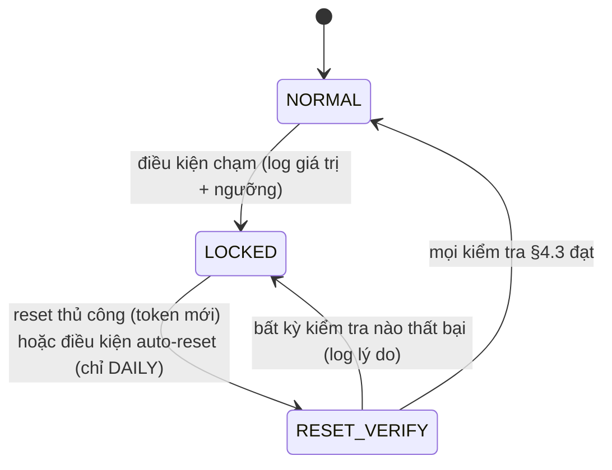

# Phase 2 — Kiến trúc, State Machine và Quy tắc đồng bộ

**Căn cứ:** Đặc tả v1.0 + Addendum V2.0 + Phase 1 Rev 1–3.
**Trạng thái:** Thiết kế. Chưa có code. Chưa compile.

---

## 1. Module và trách nhiệm

```text
XAUUSDc_AdaptiveGrid/
├── Experts/XAUUSDc_AdaptiveGrid.mq5   Inputs, OnInit/OnDeinit/OnTick/OnTimer/OnTradeTransaction, điều phối chu kỳ
└── Include/
    ├── AG_Types.mqh          Enum, struct, hằng số log/reason code (không chứa thông số broker)
    ├── AG_Environment.mqh    ValidateEnvironment(), cache symbol spec, session/trade-allowed, OrderCalcProfit sanity
    ├── AG_Indicators.mqh     InitIndicators(), ReadSnapshot(shift 1,2), release handles
    ├── AG_Signals.mqh        CheckBuySignal/CheckSellSignal (TWO/ONE_CANDLE), GetMarketRegime(), ATR sanity, filters
    ├── AG_GridManager.mqh    CalculateGridDistance(), GridTriggerHit(), NormalizeVolume(), NormalizePrice()
    ├── AG_BasketManager.mqh  CBasket (1 instance/phía): quét position, fee cache, NetProfit, TP/SL, state machine
    ├── AG_RiskManager.mqh    EstimateWorstCaseRisk(), RiskGate(), EA Daily, Account Protection, Equity HWM, Combined, Locks
    ├── AG_Execution.mqh      ExecuteOrderSafely(), CloseBasketSafely(), retcode classifier, Intent tracking
    ├── AG_Recovery.mqh       State file (version + CRC32, atomic), RecoverStateAfterRestart(), Reconcile()
    └── AG_Logger.mqh         WriteCSVLog(), journal, dashboard (VALID/INVALID/UNKNOWN)
```

Phụ thuộc một chiều: `Types ← Environment ← Indicators ← Signals/Grid ← Basket ← Risk ← Execution ← Recovery`; `Logger` được mọi module dùng. File `.mq5` là nơi duy nhất gọi `OrderSend` gián tiếp qua `Execution`.

**Bất biến kiến trúc (kiểm bằng code review / grep):**

1. Chỉ `AG_Execution` gửi request giao dịch.
2. Mọi đường mở lệnh đi qua `RiskManager.RiskGate()` ngay trước `Execution.Open()` — trong cùng một lời gọi `TryOpen()`, không có nhánh tắt.
3. Mọi đường đóng lệnh dùng `PositionSelectByTicket` + kiểm tra symbol + magic + type trước khi gửi.
4. Không hằng số broker (contract size, tick value, point, digits, volume step) trong code.

## 2. Chu kỳ xử lý

`OnTick()` và `OnTimer()` (1 giây) cùng gọi `RunCycle(source)`; cờ `g_inCycle` chống chạy lồng. `OnTimer` bảo đảm quản lý/retry/persist vẫn chạy khi không có tick (thị trường thưa, mất kết nối rồi có lại).

```text
RunCycle():
 1. SyncSnapshot()           account, tick, positions EA (theo symbol+magic+type), orders, deals mới
 2. ReconcileIntents()       request UNKNOWN/PENDING → khớp / bị từ chối / chưa kết luận
 3. UpdateExternalFlows()    nạp/rút → NetExternalFlow, AdjustedEquity, HWM
 4. NewServerDayCheck()      snapshot đầu ngày (EA floating, account adj equity), xét auto-reset Daily
 5. EvaluateRiskLocks()      Account Protection → Equity DD → Combined → EA Daily  (kích hoạt lock nếu chạm)
 6. Basket[BUY/SELL].Update()  NetProfit, TP/SL → CLOSING
 7. ProcessClosing()         đóng theo ticket, retry, xác nhận
 8. ProcessManualReset()     ResetLockTarget/Token → RESET_VERIFY
 9. PersistIfDirty()
10. if (AnyLock || SafeMode || !TradingAllowedNow) → UpdateDashboard; return
11. if (onTick && NewM1Bar) → TryInitialEntry(BUY/SELL)       [chỉ tick đầu nến]
12. if (onTick)             → TryGridAdd(BUY/SELL)            [mọi tick]
13. UpdateDashboard()
```

Bước 1–9 **luôn chạy**, không phụ thuộc ADX, tín hiệu, nến mới hay dữ liệu indicator. Indicator chỉ đọc ở bước 11–12. Lệnh mới chỉ phát sinh từ `OnTick` (cần giá mới).

`OnTradeTransaction()`: chỉ đặt cờ `g_tradeEventPending` và lưu ticket liên quan; xử lý thật ở `RunCycle` kế tiếp. Không dùng làm nguồn sự thật duy nhất.

`OnInit()`:

```text
ValidateEnvironment()  → INIT_FAILED nếu sai symbol/chart symbol/TF/currency/margin mode/spec/OrderCalcProfit/LotMultiplier/input
InitIndicators()       → INIT_FAILED nếu INVALID_HANDLE
LoadState()            → OK | FRESH_INIT | MISSING/CORRUPT/VERSION_MISMATCH
RecoverStateAfterRestart()
EventSetTimer(1)
Log toàn bộ input + spec + kết quả validation
```

`OnDeinit()`: `PersistNow()`, `EventKillTimer()`, `IndicatorRelease()`, đóng file log. **Không** đóng position, không xóa state.

## 3. State machine Basket (mỗi phía một instance)

```mermaid
stateDiagram-v2
    [*] --> IDLE
    IDLE --> ENTRY_PENDING: Signal + RiskGate OK, Intent lưu, request gửi
    ENTRY_PENDING --> ACTIVE: fill xác nhận (position + deal IN)
    ENTRY_PENDING --> IDLE: từ chối xác nhận (retcode lỗi rõ ràng, không có position)
    ENTRY_PENDING --> RECOVERY: kết quả không rõ (timeout/no connection/không thấy position)
    ACTIVE --> ADD_PENDING: Grid trigger + RiskGate OK, Intent lưu, request gửi
    ADD_PENDING --> ACTIVE: fill xác nhận hoặc từ chối xác nhận
    ADD_PENDING --> RECOVERY: kết quả không rõ
    ACTIVE --> CLOSING: TP / SL / Lock yêu cầu đóng
    ADD_PENDING --> CLOSING: TP / SL / Lock (intent vẫn được reconcile; position mới xuất hiện cũng bị đóng)
    RECOVERY --> ACTIVE: reconcile xong, có position, budget đã biết
    RECOVERY --> IDLE: reconcile xong, không position
    RECOVERY --> SAFE_MODE: quá ReconcileTimeoutSec hoặc dữ liệu mâu thuẫn
    RECOVERY --> CLOSING: Lock/SL yêu cầu đóng
    CLOSING --> IDLE: 0 position EA phía này + không intent mở + P/L cuối đã ghi
    SAFE_MODE --> CLOSING: risk state unknown & SafeModeCloseIfRiskStateUnknown, hoặc Lock yêu cầu đóng
    SAFE_MODE --> ACTIVE: đối chiếu đủ (budget + fill time + intent) — tự động
    SAFE_MODE --> IDLE: 0 position + reset thủ công có log
```



| State | Mở/thêm lệnh | TP | SL | Lock close | Ghi chú |
|---|---|---|---|---|---|
| IDLE | Entry (nếu không lock) | – | – | – | |
| ENTRY_PENDING / ADD_PENDING | Không | Có (nếu đã có position) | Có | Có | Chờ kết quả ≤ `PendingTimeoutMs` (mặc định 10 000) rồi → RECOVERY |
| ACTIVE | Add | Có | Có | Có | |
| CLOSING | Không | – | – | – | Không mở Basket mới cùng phía tới khi IDLE |
| RECOVERY | Không | Có | Có | Có | Đối chiếu mỗi chu kỳ |
| SAFE_MODE | Không | Có nếu budget đã xác minh | Có nếu budget đã xác minh | Có | Không gửi lại request cũ |

**CLOSING chi tiết:** mỗi ticket có `{attempts, lastAttemptMs}`. Một chu kỳ gửi tối đa một request đóng cho mỗi ticket chưa có request đang chờ. Retry khi `now − lastAttempt ≥ CloseRetryDelayMs` (mặc định 500 ms) và `attempts < MaxCloseRetries`. Hết số lần → không rời CLOSING; chuyển sang nhịp chậm (mỗi 30 s), log `CLOSE_RETRY_EXHAUSTED` + dashboard cảnh báo. Đóng một phần → đóng tiếp volume còn lại của chính ticket đó. Retcode `MARKET_CLOSED` / `TRADE_DISABLED` không tính vào attempts (chờ phiên mở).

## 4. Lock

### 4.1. Mô hình

Lock là **tập cờ độc lập** (có thể đồng thời), không phải một trạng thái duy nhất:

| Lock | Kích hoạt | Hành động | Reset |
|---|---|---|---|
| ACCOUNT_PROTECTION (1) | Adj equity giảm ≥ X% so với đầu ngày server | Đóng mọi position EA (nếu `CloseAllOnRiskLimit`) | Thủ công, rebase mốc đầu ngày |
| EQUITY_DD (2) | `HWM − AdjEquity ≥ HWM × MaxEquityDDPercent%` | Đóng mọi position EA | Thủ công, rebase HWM |
| COMBINED_LOSS (3) | `CombinedNet ≤ −MaxCombinedLoss` | Đóng mọi position EA | Thủ công |
| DAILY_LOSS (4) | `EADailyPL ≤ −DailyLoss` | Đóng mọi position EA | Tự động ngày server mới, nếu không có (1)(2)(3) và SAFE MODE; hoặc thủ công |

`CloseAllOnRiskLimit = false` → vẫn khóa, không đóng, log cảnh báo mỗi phút; Basket SL vẫn hoạt động.

### 4.2. Sơ đồ (cho mỗi lock)



### 4.3. RESET_VERIFY

Chỉ về NORMAL nếu tất cả đúng: không intent chờ reconcile; mọi Basket ở IDLE hoặc ACTIVE có budget đã xác minh; state file ghi được; sau rebase (nếu có) điều kiện kích hoạt của chính lock đó không còn đúng; không có lock ưu tiên cao hơn được *tạo ra* bởi việc reset. Reset lock A không thay đổi lock B.

### 4.4. Khi nhiều điều kiện cùng xảy ra (một chu kỳ)

1. Lock (theo ưu tiên 1→4) được đánh giá trước Basket TP/SL.
2. Nếu có lock yêu cầu đóng → cả hai Basket chuyển CLOSING với lý do lock (lý do cao nhất được log; các lock khác vẫn được ghi).
3. Nếu Basket đồng thời chạm TP và lock → đóng với lý do lock (lock không phụ thuộc kết quả).
4. TP và SL cùng lúc không thể xảy ra (ngưỡng trái dấu).
5. Không lệnh mới trong chu kỳ có bất kỳ lock, SAFE MODE, CLOSING, RECOVERY, PENDING nào ở phía tương ứng (lock/SAFE MODE toàn cục chặn cả hai phía).

## 5. Đồng bộ dữ liệu — nguồn sự thật

| Dữ liệu | Nguồn sự thật | Cache cục bộ | Persist |
|---|---|---|---|
| Position tồn tại, volume, giá mở, swap, profit | Terminal positions | Dựng lại mỗi chu kỳ | Không |
| Giá khớp tầng mới nhất | `POSITION_PRICE_OPEN` của position có `POSITION_TIME_MSC` lớn nhất | Có | Không |
| Fill time (cooldown) | `DEAL_TIME_MSC` của deal IN | Có | Có (`LastFillTime[side]`) |
| Commission/fee entry | Deal history theo `POSITION_IDENTIFIER` | Map posId → fee | Không (đọc lại được) |
| Realized trong ngày | Deal history từ 00:00 server | Có | Không (đọc lại được) |
| EquityAtBasketStart, Budget, EffectiveSL, BasketStartTime, BasketId | **State file** | Có | Có |
| Lock flags, ngày lock, giá trị kích hoạt, token đã dùng | **State file** | Có | Có |
| HWM, NetExternalFlow, LastFlowScanTime/Deal | **State file** | Có | Có |
| Snapshot đầu ngày (EA floating, account adj equity, ngày) | **State file** | Có | Có |
| Intent (side, magic, volume, request time, order ticket, deal ticket nếu có, retcode) | **State file** | Có | Có (ghi **trước** khi gửi request) |
| LastProcessedBar[side], LastOrderBar[side] | **State file** | Có | Có |

**Quy tắc đối chiếu khi khởi động / mỗi chu kỳ:**

| Tình huống | Xử lý |
|---|---|
| State có Basket ACTIVE, terminal có position khớp | ACTIVE |
| State có Basket ACTIVE, terminal không có position | Đọc deal OUT để xác nhận đã đóng → IDLE (log `CLOSED_WHILE_OFFLINE`); không xác nhận được → SAFE_MODE |
| State IDLE/không có, terminal có position EA | Budget không biết → SAFE_MODE (+ đóng khẩn cấp nếu `SafeModeCloseIfRiskStateUnknown`) |
| Số tầng > MaxLayers hoặc volume > MaxSideLots | SAFE_MODE, log `LAYER_LIMIT_VIOLATION` |
| Position magic EA nhưng sai type | Bỏ qua (không đóng, không tính), SAFE_MODE phía đó, log |
| Intent tồn tại | Reconcile: tìm order/deal/position theo magic + symbol + side + volume + thời gian ≥ request time (− 2 s) + order ticket nếu đã có. Tìm thấy fill → gắn vào Basket; xác nhận không có (retcode lỗi rõ ràng và không có deal/position/order sau `ReconcileTimeoutSec`) → xóa intent; mơ hồ → SAFE_MODE |
| State file thiếu / CRC sai / version sai | Nếu đủ điều kiện FRESH_INIT (Rev 2 N-03) → khởi tạo sạch; ngược lại → SAFE_MODE + **mọi lock = LOCKED** |

## 6. Persistent state

- **Vị trí:** `MQL5/Files/AdaptiveGrid/AG_<login>_<serverHash>_<symbol>_<magicBuy>_<magicSell>[_TESTER].state`.
- **Định dạng:** text `key=value`, dòng đầu `schema=1`, dòng cuối `crc32=<hex>` tính trên toàn bộ nội dung phía trên.
- **Ghi atomic:** ghi `.tmp` → `FileFlush` → đọc lại kiểm CRC → `FileMove(.tmp → .state, FILE_REWRITE)`; giữ `.bak` bản trước chỉ để chẩn đoán, **không** dùng để khôi phục tự động (bản cũ có thể thiếu lock mới hơn).
- **Khi ghi:** mọi thay đổi state machine/lock/intent (ghi đồng bộ, trước khi gửi request với intent); HWM khi tăng (throttle 5 s, và luôn khi `OnDeinit`); snapshot đầu ngày.
- **Ghi thất bại:** chặn lệnh mới (`STATE_WRITE_FAILED`), vẫn quản lý/đóng; thử lại mỗi chu kỳ.
- **Version mismatch:** không tự migrate ở schema 1; xử lý như CORRUPT.
- **Tester:** hậu tố `_TESTER`, xóa ở `OnInit` khi `MQL_TESTER` để mỗi lần chạy độc lập.

| Nhóm | Trường |
|---|---|
| Header | schema, symbol, magicBuy, magicSell, login, server, writeTime |
| Basket ×2 | state, basketId, startTime, equityAtStart, riskBudget, effectiveSL, lastFillTimeMsc, lastOrderBar, lastProcessedBar, closeReason |
| Intent ×2 | active, side, magic, volume, requestTimeMsc, orderTicket, dealTicket, retcode, kind(ENTRY/ADD) |
| Locks ×4 | active, triggerTime, triggerValue, threshold, lockDate (Daily) |
| Reset | lastResetToken |
| Daily | serverDate, eaFloatingAtDayStart, accountAdjEquityAtDayStart |
| Equity | hwm, netExternalFlow, lastFlowScanTime, lastFlowDealTicket |
| SafeMode | active ×2 + global, reason |

## 7. Ưu tiên khi xung đột (tóm tắt)

`Đồng bộ/Reconcile > Lock (1→4) > Basket SL > Basket TP > Close retry > Reset thủ công > SAFE MODE gating > Filters (ADX/spread/session/ATR) > Cooldown/1-lệnh-mỗi-nến > Signal/Grid trigger > Risk Gate > Gửi lệnh`.

Risk Gate đứng ngay trước gửi lệnh và không thể bị bỏ qua bởi bất kỳ bước nào phía trước.

## 8. Verification loop Phase 2

| Kiểm tra | Kết quả |
|---|---|
| Addendum §1/§11: thứ tự OnTick, không return sớm trước risk/TP/SL | Bước 1–9 vô điều kiện; OnTimer bổ sung khi không tick |
| Addendum §9.3: đủ trường persist | Đủ (bảng §6), thêm HWM/flows/reset token theo Rev 3 |
| Addendum §10: reconcile không dựa duy nhất vào comment | Dùng order/deal/position ticket + magic + symbol + side + volume + time; comment chỉ hỗ trợ |
| Rev 3 D-03: Daily không reset khi có lock cao hơn/SAFE MODE | §4.1 |
| Rev 3 D-06: reset một lock không reset lock khác | §4.3 |
| Master prompt Phase 2 mục 1–7 | §1–§7 |
| Chưa xác minh | Toàn bộ — chưa có code; hành vi `FileMove`, `HistorySelect` hiệu năng với lịch sử dài cần đo khi compile/test |
